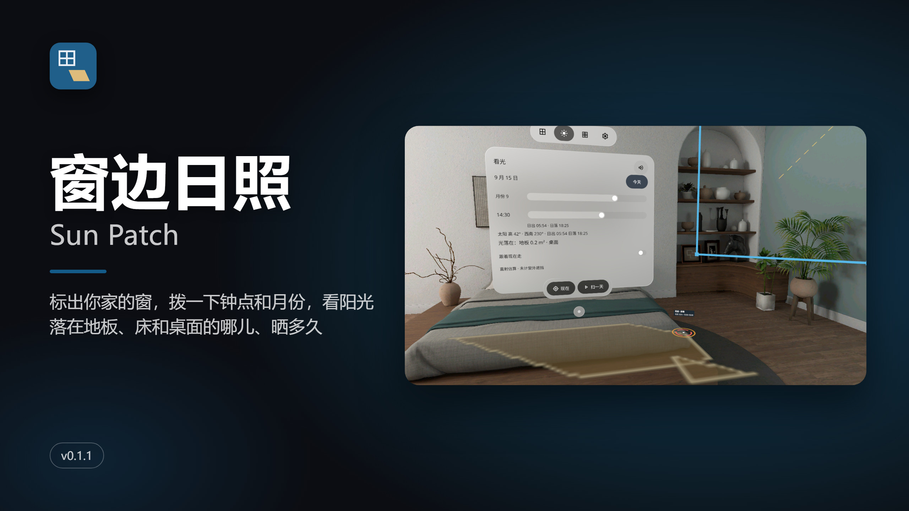
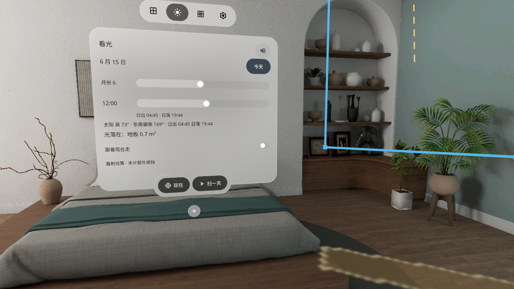
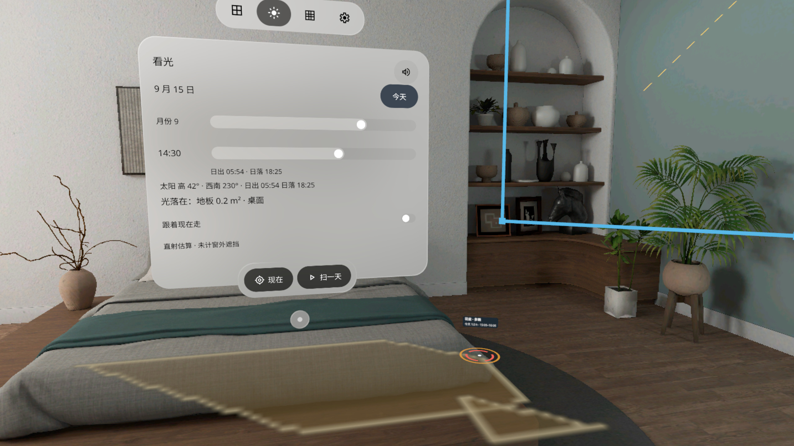
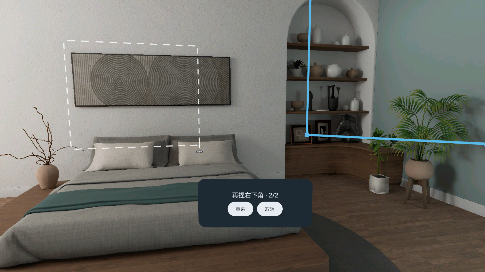
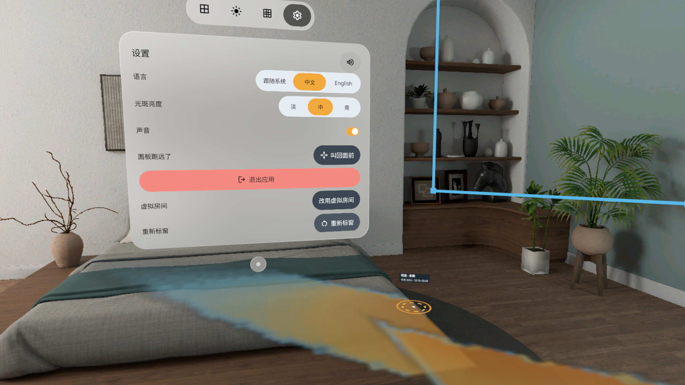
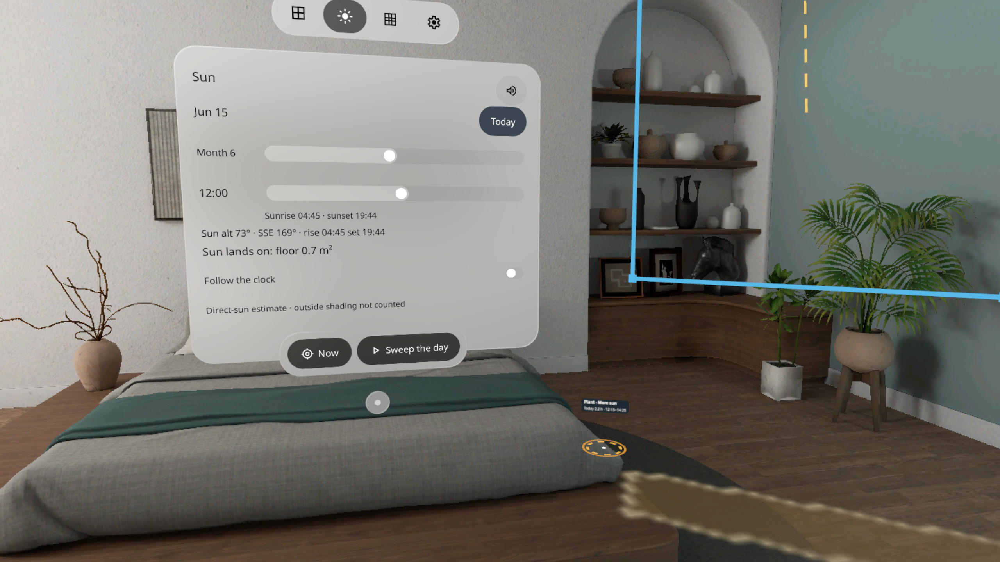
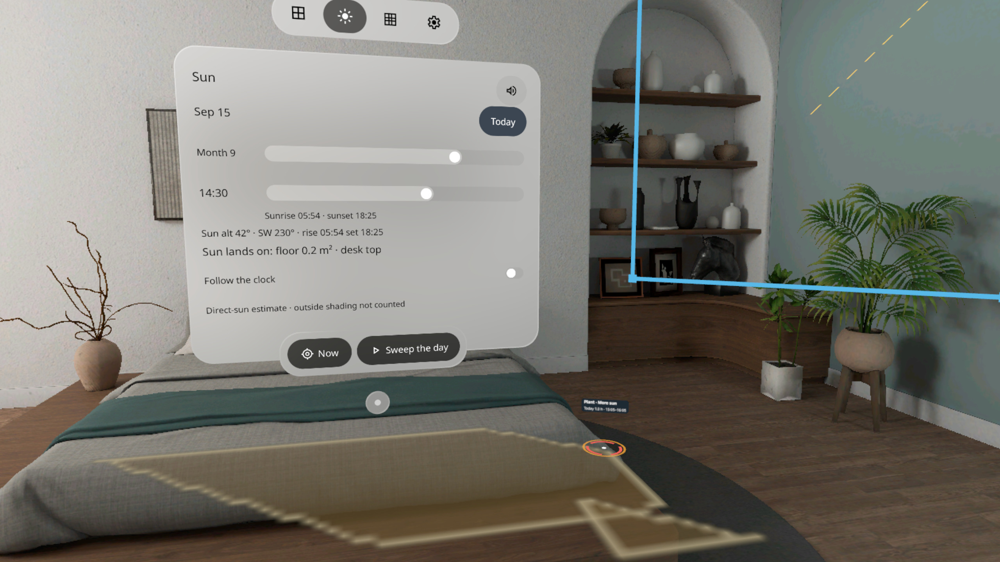
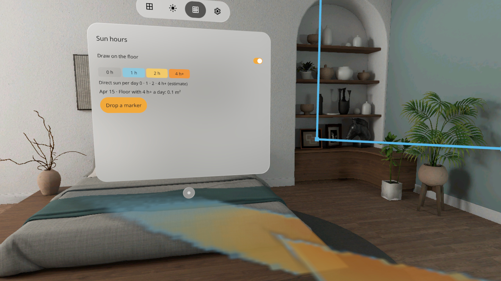
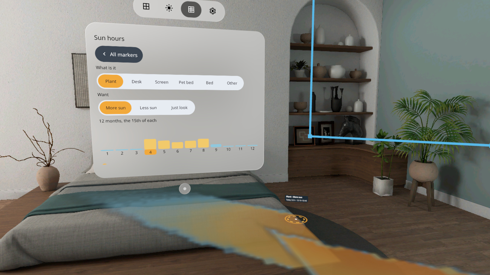
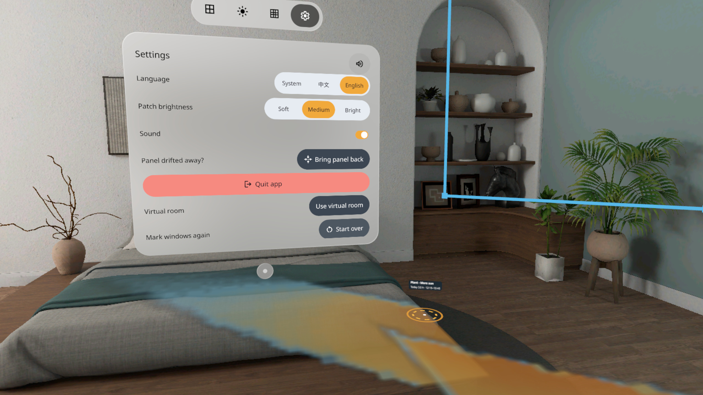

# 窗边日照 Sun Patch



[中文](#中文) · [English](#english)

## 中文

标出你房间里真实的窗，告诉它窗朝哪边、你在哪个城市。拨一下钟点和月份，穿过这扇窗的直射光斑就按真实大小铺在你的地板、床和桌面上：光从哪儿进来、落到哪儿、晒多久，一眼看清。PICO OS 6 混合现实应用（PICO Spatial SDK 6.1.9，Kotlin）。

- **看光**：拖「月份」「钟点」滑条，光斑跟着挪；面板写着太阳高度、方位、日出日落和光落在哪个面、多大面积；[现在]、「跟着现在走」、[扫一天]
- **日照图**：扫完一天，地上按每天晒几小时画成 0 / 1 / 2 / 4 h+ 四种颜色；放标记（花盆、书桌、屏幕、猫窝、床……）看 12 个月各晒多久
- **标窗**：手柄射线或注视 + 捏合，捏窗的左上角、右下角就标好；或者 [放一扇标准窗]；没扫到房间就用虚拟房间
- 主面板开在窗旁边，不挡你标好的窗；窗和标记存进空间锚点，下次打开还在
- 只算直射阳光，窗外的楼、树、屋檐和窗帘不计：是参考，不是承诺
- 中英双语，全部本机运行，不联网、不需要账号

| | |
|---|---|
|  |  |
|  |  |
|  |  |

截图来自 PICO 模拟器（调试命令驱动状态），**不是真实手势录像**。

### 安装

[Release v0.1.1](https://github.com/kejing-dev/SunPatch/releases/tag/v0.1.1) 里的 `SunPatch-v0.1.1.apk` 是 `assembleRelease` 出的**未签名**包（给 Vibe Lab 上架用），不能直接 `adb install`。自己装请从源码出 debug 包：

```bash
./gradlew assembleDebug
adb install -r app/build/outputs/apk/debug/app-debug.apk
pico-cli app launch io.embodit.sunpatch
```

构建细节见 [AGENTS.md](AGENTS.md)。

## English

Mark a real window in your room, tell the app which way it faces and which city you are in, then drag the clock and the month: the patch of direct sun that comes through that window falls on your real floor, bed and desk at full size. A PICO OS 6 mixed-reality app (PICO Spatial SDK 6.1.9, Kotlin).

- **Sun**: drag the Month and Time sliders and the patch moves; the panel shows sun altitude, bearing, sunrise / sunset, and which surface the light lands on and how big it is; Now, Follow the clock, Sweep the day
- **Sun hours**: after a sweep the floor is painted by hours of direct sun per day (0 / 1 / 2 / 4 h+); drop markers (plant, desk, screen, pet bed, bed…) and see their hours for every month
- **Mark a window**: controller ray or gaze + pinch on the top-left and bottom-right corners, or place a standard window; a virtual room stands in when no room scan is available
- The main panel opens beside the window instead of covering it; windows and markers are saved in spatial anchors
- Direct sun only: buildings, trees, eaves and curtains outside are not counted. A guide, not a promise
- Chinese and English, fully offline, no account

| | |
|---|---|
|  |  |
|  |  |
|  |  |

Screenshots are from the PICO emulator, driven by debug commands. **Not a recording of real hand input.**

### Install

`SunPatch-v0.1.1.apk` in [Release v0.1.1](https://github.com/kejing-dev/SunPatch/releases/tag/v0.1.1) is an **unsigned** `assembleRelease` build for store submission and cannot be installed with `adb install` as is. To try it yourself, build the debug APK:

```bash
./gradlew assembleDebug
adb install -r app/build/outputs/apk/debug/app-debug.apk
pico-cli app launch io.embodit.sunpatch
```

See [AGENTS.md](AGENTS.md) for build details.

Fonts: Noto Sans / Noto Sans SC, SIL Open Font License 1.1.
